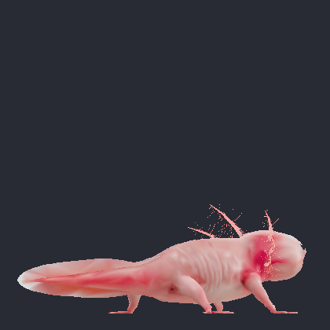
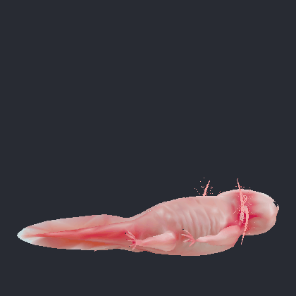
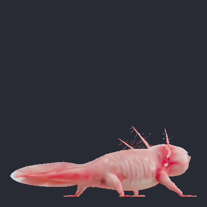

# Pink Axolotl (animated) — Fabric 1.20.1

Substitui o modelo do axolote vanilla por um axolote com esqueleto completo e 4 animações
(**Idle_Breathe, Walk, Swim, Eat**) com crossfade. Só cliente: funciona em servidores vanilla;
IA, hitbox, baldes e reprodução continuam sendo os do axolote normal.

## Preview
   

## Build
Requer JDK 17+ e internet na primeira vez (baixa Minecraft/Yarn/Fabric):

    ./gradlew build        # jar em build/libs/pink-axolotl-1.0.0.jar

CI: `.github/workflows/build.yml` compila a cada push/PR (artifact com o jar) e, ao criar uma tag `v*`, publica o jar numa Release.

Teste rápido: `./gradlew runClient`, entre num mundo e dê `/summon minecraft:axolotl`.
Coloque o jar em `mods/` junto com o Fabric API (0.92.x) para jogar.

## Como funciona
* `assets/pinkaxolotl/models/axolotl.axm` — malha (6 063 vértices / 8 379 triângulos, cores baked), 158 ossos, 4 clipes a 30 fps.
* `core/` — Java puro (sem Minecraft): loader, amostragem/blend de clipes, skinning em CPU, máquina de estados.
* `client/` — `PinkAxolotlRenderer` (LivingEntityRenderer) + `PinkAxolotlModel`; registrado via `EntityRendererRegistry.register(EntityType.AXOLOTL, …)`.
* Seleção de animação (`PinkAxolotlModel.setAngles`): parado → Idle; em movimento no chão (inclusive no fundo da água) → Walk;
  em movimento na água sem tocar o chão → Swim; golpe/mordida (`handSwinging`) → Eat uma vez. Velocidade do ciclo escala com a velocidade real.
* `tools/exporter/` — pipeline Python que gerou o `.axm` a partir do FBX (parser FBX, QEM, bake de cor). Ajuste
  `CFG` em `build_model.py` (ex.: `body=3600`) para mais/menos polígonos.

## Ajustes comuns
* Tamanho visual: `VISUAL_SCALE` em `PinkAxolotlRenderer` (2.0 = dobro; só visual, a hitbox continua a do vanilla).
* Tamanho base: `LEN` em `build_model.py` (0.80 = comprimento focinho→cauda em blocos).
* Custo: ~0,3 ms de CPU por axolote visível (skinning) + 4 vértices por triângulo enviados ao buffer.

Licença/créditos: veja `CREDITS.md` (modelo CC BY-NC 4.0 — uso não comercial, com atribuição).
